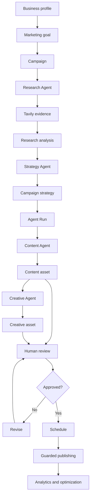
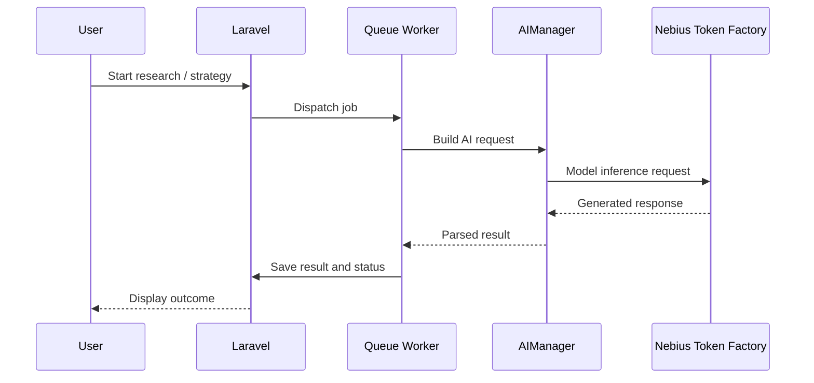

# PostGenius Agent

**An AI-powered marketing workspace for research, strategy, content, creatives, approvals, scheduling, and campaign intelligence.**

> **Project status:** V1 development / validation. The public repository should contain the actual, tested application source. Some modules and integrations may require configuration or additional acceptance testing.

**Live application:** https://pg-agent.itmarketz.com  
**Core reasoning model:** `nvidia/NVIDIA-Nemotron-3-Nano-30B-A3B` via **Nebius Token Factory**  
**Backend:** Laravel 13, PHP 8.3+, MySQL  
**Research integration:** Tavily  
**Optional image generation:** OpenAI `gpt-image-1`

> **Repository maintainers:** Replace any remaining placeholders, validate the setup against the final merged Phase 1–21 source, and remove secrets before publishing.

---

## 1. Overview

PostGenius Agent brings multiple stages of digital marketing into one coordinated workspace. Instead of asking a chatbot to write a single caption, users can define a business and marketing objective, collect external research, develop a strategy, generate campaign content, prepare creative assets, review outputs, and plan publication.

The application is built around persistent business and campaign records, AI provider abstraction, asynchronous background jobs, and human approval gates.

### The problem

Marketing teams often work across disconnected systems:

- Research tools for market and competitor insights.
- Documents and spreadsheets for campaign planning.
- Generative AI interfaces for captions and copy.
- Image tools for visual concepts.
- Approval threads and publishing calendars.
- Analytics dashboards that are difficult to connect back to the original campaign objective.

This creates repetitive work and weak traceability between **evidence → strategy → content → execution → results**.

### Our approach

PostGenius Agent organizes those steps as linked workflows. Each agent has a defined responsibility and its output can be used by the next stage. Users remain in control of review and publishing decisions.

---

## 2. Main capabilities

| Area | Purpose | Notes |
|---|---|---|
| Business workspace | Store brand and business context | Business-scoped data and authorization |
| Marketing goals | Define campaign objectives | Linked to a business |
| Campaigns | Organize execution | Campaign-specific research and strategy |
| Research Agent | Plan research and interpret external evidence | Tavily + configured language model |
| Strategy Agent | Produce structured campaign strategy | Uses research context; validates AI output |
| Agent Center | Track coordinated agent executions | Queue-backed run lifecycle |
| Content Agent | Create campaign copy and drafts | Requires eligible campaign/agent run |
| Content Library | Review and manage generated assets | Human editing and approval workflow |
| Creative Agent | Generate image concepts and creative assets | Image provider is optional and separately configured |
| Creative Library | Review generated visuals | Brand checks and manual review |
| Approvals | Review content and publication decisions | Publishing must respect safeguards |
| Schedule | Plan publication | Requires configured publisher integrations and scheduler |
| Activity and AI Usage | Inspect execution and provider activity | Costs reflect recorded data, not necessarily invoices |
| Performance | View recorded campaign/social metrics | Depends on analytics sync and connected accounts |
| System Settings | Manage available application preferences | Some settings do not change infrastructure automatically |

**Implementation note:** The last full source archive reviewed for this README predates the later Phase 16–21 patch packages. The final public repository must merge those packages and verify each corresponding route and feature before representing it as fully operational.

---

## 3. How the agents work together



The diagram describes the intended end-to-end workflow. Individual steps are subject to configured integrations, permissions, queue workers, and approval status.

### Research Agent

The Research Agent can generate search queries, request external research from Tavily, and use the configured model to organize evidence into a research result. The research pipeline is designed to keep external findings separate from AI interpretation.

### Strategy Agent

The Strategy Agent uses campaign context and research results to produce structured recommendations. AI output is validated before it is accepted as a completed strategy. Invalid JSON or incomplete output should be treated as an error, not silently represented as success.

### Content Agent

The Content Agent creates marketing drafts tied to an existing campaign execution. Generated tasks and resulting content assets are different records: a queued task does not necessarily mean a usable asset has been created.

### Creative Agent

The Creative Agent works from eligible content assets. Image generation uses a separate provider, configured through environment variables. Brand checks and human approval are important because automated text-based checks cannot guarantee visual accuracy, logo fidelity, or rights clearance.

### Human oversight

Generated content should not be assumed ready to publish. Users must review factual claims, trademarks, brand consistency, images, and platform compliance before approving external publication.

---

## 4. NVIDIA Nemotron and Nebius integration

PostGenius Agent uses a provider abstraction instead of hard-coding AI requests throughout the application.

Relevant source locations include:

- `config/ai.php` — default provider, endpoint, model, timeout, and generation settings.
- `app/AI/Providers/NebiusProvider.php` — Nebius API adapter.
- `app/AI/Services/` — AI orchestration and shared services.
- `app/AI/DTOs/` — request/response data transfer objects.
- `app/AI/Agents/ResearchAgent.php` and `StrategyAgent.php` — agent-specific reasoning workflows.
- `app/Jobs/` — asynchronous execution.

The configured model in the reviewed source is:

```text
nvidia/NVIDIA-Nemotron-3-Nano-30B-A3B
```

Typical request flow:



**Why Nemotron matters:** The model provides the language reasoning used to interpret research context and structure marketing recommendations. Tavily supplies external research, and the image provider handles visual generation; these are distinct integrations.

**Do not claim:** that Nemotron generates images, that every agent uses the same provider, or that every workflow is autonomous without human review.

---

## 5. Technology stack

| Layer | Technology |
|---|---|
| Backend | PHP 8.3+, Laravel 13 |
| Database | MySQL (configured in the supplied `.env.example`) |
| UI | Laravel Blade, Vite, JavaScript/CSS |
| Authentication | Laravel authentication components |
| Background work | Laravel queues, database queue driver by default |
| Scheduling | Laravel task scheduler |
| AI reasoning | NVIDIA Nemotron through Nebius Token Factory |
| External research | Tavily API |
| Optional image generation | OpenAI image API |
| Social integration | Meta APIs, where configured and authorized |
| Tests | Pest / Laravel test runner |

---

## 6. Prerequisites

Before installation, prepare:

1. PHP **8.3 or later**, Composer, and the PHP extensions required by Laravel and the chosen database driver.
2. Node.js and npm compatible with the project's `package.json` / lockfile.
3. MySQL database and a database user with appropriate permissions.
4. Nebius Token Factory API key with access to the configured Nemotron model.
5. Tavily API key for external research.
6. Optional OpenAI API key for image generation.
7. A way to run Laravel queue workers and the scheduler.
8. HTTPS and properly configured credentials for any social publishing integrations.

You can run the interface without optional image/social integrations, but their related actions will not work until configured.

---

## 7. Local installation

### Step 1 — Clone the repository

```bash
git clone https://github.com/YOUR-USERNAME/postgenius-agent.git
cd postgenius-agent
```

Replace `YOUR-USERNAME` with the actual GitHub account or organization.

### Step 2 — Install dependencies

```bash
composer install
npm ci
```

If the project does not have a compatible `package-lock.json`, use `npm install` and commit the resulting lockfile.

### Step 3 — Create a local environment

```bash
cp .env.example .env
php artisan key:generate
```

**Important:** The reviewed source archive's `.env.example` contains a nonempty `APP_KEY` and weak sample administrator credentials. **Before publishing**, change the example to `APP_KEY=` and remove default administrator credentials. Never publish a real key or password.

### Step 4 — Configure the database

Example values for a **local development** database:

```dotenv
APP_NAME="PostGenius Agent"
APP_ENV=local
APP_DEBUG=true
APP_URL=http://127.0.0.1:8000

DB_CONNECTION=mysql
DB_HOST=127.0.0.1
DB_PORT=3306
DB_DATABASE=postgenius_agent
DB_USERNAME=YOUR_LOCAL_DB_USER
DB_PASSWORD=YOUR_LOCAL_DB_PASSWORD

QUEUE_CONNECTION=database
SESSION_DRIVER=database
CACHE_STORE=database
```

Create the database separately using MySQL administration tools.

### Step 5 — Configure AI and research

```dotenv
AI_DEFAULT_PROVIDER=nebius
AI_REQUEST_TIMEOUT=120

NEBIUS_API_KEY=YOUR_NEBIUS_KEY
NEBIUS_BASE_URL=https://api.tokenfactory.nebius.com/v1/
NEBIUS_DEFAULT_MODEL=nvidia/NVIDIA-Nemotron-3-Nano-30B-A3B
NEBIUS_MAX_TOKENS=4096

RESEARCH_SEARCH_PROVIDER=tavily
TAVILY_API_KEY=YOUR_TAVILY_KEY
TAVILY_BASE_URL=https://api.tavily.com
```

These are examples. API keys must remain in your private `.env`, secret manager, or deployment environment—not GitHub.

### Step 6 — Optional creative generation

```dotenv
CREATIVE_IMAGE_PROVIDER=disabled
CREATIVE_OPENAI_API_KEY=
CREATIVE_OPENAI_IMAGE_MODEL=gpt-image-1
CREATIVE_STORAGE_DISK=local
```

To enable image generation, use the exact provider identifier supported by your installed code, supply a valid key, and verify storage permissions. Do not assume that changing `disabled` alone makes image generation work.

### Step 7 — Run migrations

```bash
php artisan migrate
```

For development-only seed data, inspect the seeders first:

```bash
php artisan db:seed
```

**Warning:** The reviewed `DatabaseSeeder` calls `AdminUserSeeder` and `AIProviderSeeder`. Review administrator creation and credentials before seeding any internet-accessible environment.

### Step 8 — Build frontend assets

```bash
npm run build
```

For active frontend development, you may use `npm run dev` in a separate terminal.

### Step 9 — Start Laravel

```bash
php artisan serve
```

Open `http://127.0.0.1:8000`.

### Step 10 — Run queue workers

In another terminal:

```bash
php artisan queue:work --queue=research,agents,creative,publishing,optimization,agent-loop,default --tries=3 --timeout=300
```

This is a development example, not a production supervisor configuration. Confirm actual queue names with the final merged source. Set the queue connection's `retry_after` higher than the worker timeout and ensure external API timeouts are compatible.

### Step 11 — Run the scheduler

For local testing:

```bash
php artisan schedule:work
```

For production, configure a system cron entry that runs `php artisan schedule:run` every minute. **Before enabling publishing**, verify that only one due-publication dispatcher is registered.

---

## 8. First-run walkthrough

1. **Sign in** with an account created through the application's supported authentication flow.
2. **Create a business** with relevant brand, audience, and product/service information.
3. **Create a marketing goal** linked to that business.
4. **Create a campaign** linked to the goal.
5. **Run research** and wait for the research job to complete.
6. **Generate a strategy** using the completed research.
7. **Create an Agent Run** from the campaign's agent workflow. In the reviewed source, the creation page follows `/campaigns/{campaign}/agent`.
8. **Open Content Agent**, select an eligible run, and generate a draft.
9. **Verify the Content Asset** appears in Content Library.
10. **Open Creative Agent**, select the same business and an eligible Content Asset, and request an image if the image provider is enabled.
11. **Review outputs** and approve or revise them.
12. **Schedule publication** only after social integrations and publishing safety controls have been tested.
13. **Inspect Activity, AI Usage, and Performance** for recorded results.

### Troubleshooting missing dropdown options

**No Agent Runs:** Verify that the business/campaign exists and the required research and strategy stages have completed. Confirm the logged-in user can access the business.

**No Content Assets:** A queued content task is not the same as a generated asset. Check job completion, asset status, business association, and the Content Library.

**No Creative Assets:** Confirm an eligible Content Asset exists, image generation is configured, the creative queue is running, and the generation job has completed.

---

## 9. Background jobs and reliability

The reviewed source contains jobs for:

- Campaign research.
- Strategy generation.
- Agent run execution.
- Content generation.
- Creative asset generation.
- Social publishing and due-publication dispatch.
- Social analytics synchronization.
- Campaign optimization.
- Campaign memory refresh.

Recommended diagnostics:

```bash
php artisan queue:failed
php artisan queue:work --once -v
php artisan schedule:list
php artisan route:list
php artisan test
```

If a job fails, inspect the relevant log **locally**, remove secrets and personal data, and use a safe retry strategy. Do not indiscriminately retry publishing jobs without checking whether a post was already sent.

---

## 10. Security and responsible operation

PostGenius Agent is intended to use business-scoped authorization, protected admin routes, and human oversight. These controls must be verified in the final deployment.

### Security checklist

- Set `APP_ENV=production` and `APP_DEBUG=false` in production.
- Use unique administrator credentials and strong passwords.
- Keep all provider keys and database credentials outside Git.
- Restrict business/campaign records to authorized users.
- Protect admin routes and sensitive operations.
- Validate upload type, size, storage location, and access permissions.
- Review outbound content and image rights before publishing.
- Keep the publishing kill switch active until controlled tests pass.
- Avoid exposing private creative files through public URLs.
- Rotate any key that has appeared in screenshots, logs, messages, or commits.
- Never expose debug exception pages publicly.

### Publishing safety

The source includes environment settings such as:

```dotenv
PUBLISH_KILL_SWITCH=true
PUBLISH_REQUIRE_GOVERNANCE=true
```

Keep publishing disabled while testing. Before live use, confirm the actual enforcement logic, social account permissions, duplicate-publication protection, and a single scheduler/dispatcher path.

---

## 11. Testing

Run:

```bash
php artisan test
```

Use a **separate test database**. Do not point test commands at production data.

Recommended acceptance coverage:

| Test | Expected outcome |
|---|---|
| Authentication | Unauthorized users cannot access private workspace |
| Business isolation | Users cannot read or mutate another business's records |
| Research | Job completes or records a useful failure |
| Strategy | Structured output validates before persistence |
| Agent Run | Eligible campaigns can create runs |
| Content | Task completes and creates a usable Content Asset |
| Creative | Eligible asset produces a reviewed creative or actionable error |
| Approval | Unapproved content cannot bypass required review |
| Publishing | Kill switch prevents live publication |
| Scheduler | Only one due-publication dispatcher is active |
| Usage | Provider events are recorded without leaking API keys |
| UI | Desktop and mobile views remain usable |
| Failure recovery | Jobs handle missing records, timeouts, and retries safely |

**Verification disclosure:** This README was prepared from the latest full source archive available in the conversation and the described later phase packages. It does **not** certify that every test above currently passes.

---

## 12. Deployment

For a production environment:

1. Deploy the reviewed, sanitized source code.
2. Configure HTTPS, web server document root (`public/`), database, queues, mail, storage, and secrets.
3. Install dependencies using production-safe Composer/npm commands.
4. Run migrations after taking a backup.
5. Build frontend assets.
6. Cache configuration, routes, and views.
7. Start supervised queue workers.
8. Configure the Laravel scheduler.
9. Run a controlled smoke test.
10. Keep external publishing disabled until explicitly approved.

Typical commands:

```bash
composer install --no-dev --optimize-autoloader
npm ci
npm run build

php artisan migrate --force
php artisan config:cache
php artisan route:cache
php artisan view:cache
php artisan queue:restart
```

Only run commands after confirming the target environment and taking a backup. Avoid destructive migration or database-reset commands on production.

---

## 13. Configuration reference

| Variable | Purpose |
|---|---|
| `AI_DEFAULT_PROVIDER` | Default AI provider |
| `NEBIUS_API_KEY` | Nebius authentication |
| `NEBIUS_BASE_URL` | Token Factory API endpoint |
| `NEBIUS_DEFAULT_MODEL` | Nemotron model identifier |
| `AI_REQUEST_TIMEOUT` | AI request timeout |
| `TAVILY_API_KEY` | Research search authentication |
| `CREATIVE_IMAGE_PROVIDER` | Image provider selection |
| `CREATIVE_OPENAI_API_KEY` | Optional image-generation authentication |
| `QUEUE_CONNECTION` | Queue backend |
| `PUBLISH_KILL_SWITCH` | Publishing safety gate |
| `PUBLISH_REQUIRE_GOVERNANCE` | Publication governance setting |
| `META_APP_ID` / `META_APP_SECRET` | Optional Meta integration |
| `ANALYTICS_ENABLED` | Analytics feature setting |
| `OPTIMIZATION_ENABLED` | Optimization feature setting |

See `config/` and `.env.example` for the authoritative set of options in your checked-in release.

---

## 14. Known limitations and roadmap

- AI outputs can contain factual inaccuracies and require review.
- External research quality depends on search coverage and source reliability.
- Creative image generation depends on a separately configured provider.
- Social publishing depends on platform permissions, token validity, and safety controls.
- Analytics depend on successful provider synchronization and may not be real-time.
- Usage-cost records may not reconcile with provider invoices.
- Agent queues and schedulers require continuous operational monitoring.
- The Phase 16–21 modules must be verified against the **final merged repository**, not assumed present merely because separate patch ZIPs were generated.

Planned improvements include stronger structured-output recovery, broader platform integrations, richer reporting, more robust tenant-isolation tests, and improved operational monitoring.

---

## 15. Project demo and evaluation

**Application:** https://pg-agent.itmarketz.com

A suggested demonstration sequence:

1. Show a configured business and marketing goal.
2. Open a completed research result and identify its evidence.
3. Show the strategy derived from that research.
4. Open an Agent Run and generate content.
5. Show the Content Asset in Content Library.
6. Generate or show a reviewed Creative Asset.
7. Demonstrate approval and scheduling controls.
8. Show activity and AI usage records.
9. Explain where Nemotron, Tavily, and image generation are each used.

Use sanitized demonstration data. Provide judge credentials through the submission's private testing instructions, **not** in this public README.

---

## 16. Repository and contribution guidance

Recommended public repository contents:

- Application source, routes, migrations, and tests.
- Dependency manifests and lockfiles.
- Sanitized `.env.example`.
- This README and architecture/demo documentation.
- Screenshots containing no personal or sensitive information.
- An appropriate project license.

Do not commit `.env`, logs, database exports, session data, private credentials, `vendor/`, or `node_modules/`.

### Contributing

Issues and pull requests are welcome if the maintainers enable public collaboration. Please include reproduction steps, affected routes or classes, and test coverage where applicable. Never include secrets or customer data in issues.

### Security reports

Do not disclose vulnerabilities or exposed credentials in public issues. Contact the repository maintainer privately using a verified project contact channel.

---

## 17. License

**License to be confirmed by the repository owner.** The Laravel framework has its own license; that does not automatically determine the license for all custom PostGenius Agent source code, images, and third-party assets.

Before public release, add a `LICENSE` file reflecting the license you intend to grant and verify compatibility with third-party dependencies and competition requirements.

---

## 18. Credits

**Developed by IT Marketz.**

Built with Laravel and integrated with NVIDIA Nemotron via Nebius Token Factory, Tavily for research, and optional image-generation and social-platform APIs.

Third-party products, trademarks, and services belong to their respective owners.
