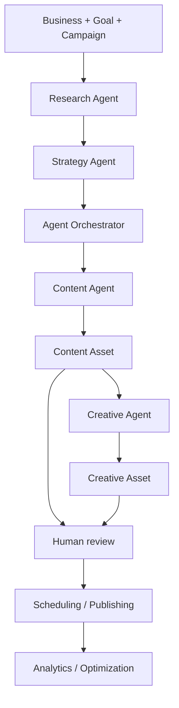

# PostGenius Agent — AI Agents and Orchestration

**Repository documentation:** `docs/AGENTS.md`  
**Note:** The project already contains a root-level `AGENTS.md` with Laravel tooling instructions. Keep that file intact; this document describes the application's *marketing AI agents*.

## 1. Agent system at a glance

PostGenius Agent coordinates multiple specialized workflows over persistent campaign data. The system uses Laravel jobs and Eloquent records to preserve state, while the `AIManager` routes language-model requests to Nebius Token Factory.



The flow is staged; agents are not assumed to act without user initiation or approvals.

## 2. Research Agent

**Code:** `app/AI/Agents/ResearchAgent.php`  
**Execution:** `app/Jobs/RunCampaignResearch.php`  
**Dependencies:** `AIManager`, `WebSearchManager`, `ResearchEvidenceBuilder`.

**Purpose:** Research planning, evidence retrieval, and structured interpretation for a campaign.

**Inputs:** `ResearchRun`, linked `Campaign`, business products/services, audiences, competitors, marketing goal, and available intelligence.

**Processing:**
1. Mark run as planning.
2. Ask the model to prepare research queries.
3. Save queries and fetch results through Tavily.
4. Build evidence from retrieved results.
5. Ask the model to analyze that evidence.
6. Save structured research outputs or record an error.

**Output:** Completed `ResearchRun` and associated queries/sources. The code rejects runs with no usable sources.

**Guardrails:** Treat external pages as evidence, not instructions; review unsupported assertions; handle timeouts and malformed JSON.

## 3. Strategy Agent

**Code:** `app/AI/Agents/StrategyAgent.php`  
**Execution:** `app/Jobs/GenerateCampaignStrategy.php`

**Purpose:** Turn campaign context and completed research into structured marketing actions.

**Inputs:** `CampaignStrategy`, research and source records, campaign/business context.

**Processing:** Prepare prompt, call `AIManager` in JSON mode, parse and validate required fields, retry invalid responses as implemented, then persist strategy/action/evidence records.

**Output:** Campaign strategy with action items and supporting evidence.

**Guardrails:** Invalid or incomplete output must not be presented as a completed strategy. A successful HTTP response does not guarantee valid strategy JSON.

## 4. Agent Orchestrator

**Code:** `app/AI/Orchestration/AgentOrchestrator.php`  
**Supporting code:** `AgentRunContext.php`, `AgentTaskPlanner.php`, `app/AI/Tools/`, `app/Jobs/ExecuteAgentRun.php`.

**Purpose:** Coordinate execution from completed research and strategy.

**Inputs:** `AgentRun`, campaign, business, research, strategy, business agent-control settings.

**Tool registry:** `ToolRegistry` registers:
- `GetBusinessProfileTool`
- `GetCampaignTool`
- `GetResearchTool`
- `GetStrategyTool`
- `GetStrategyActionsTool`

**Execution:** The orchestrator marks run stages and progress, retrieves scoped context using `ToolExecutor`, validates prerequisites, and plans tasks from strategy actions.

**Output:** Updated `AgentRun`, related tasks, activities, and tool-call records.

**Operational distinction:** An Agent Run is a persistent workflow instance, not a new model or a free-form conversation.

## 5. Content Agent

**Code:** `app/AI/Content/ContentAgent.php`  
**Execution:** `app/Jobs/GenerateContentTask.php`  
**UI:** `app/Http/Controllers/ContentAgentWorkspaceController.php`, `/content-agent`.

**Purpose:** Produce campaign-aware copy and draft assets.

**Inputs:** Eligible `AgentTask`, `AgentRun`, campaign, business, selected platform and content type, user instructions.

**Output:** `ContentAsset` with title, hook, caption, CTA, hashtags, variants, creative brief, and AI provider/model metadata.

**Prerequisites:** A business-accessible Agent Run tied to a valid campaign. The task must complete successfully to create an asset.

**Review:** Assets are initially drafts and include metadata indicating approval is required.

## 6. Creative Agent

**Code:** `app/AI/Creative/CreativeAgent.php`  
**Execution:** `app/Jobs/GenerateCreativeAsset.php`  
**UI:** `app/Http/Controllers/CreativeAgentWorkspaceController.php`, `/creative-agent`.

**Purpose:** Create a structured visual concept from an eligible Content Asset.

**Inputs:** Business brand details and Content Asset content.

**Nemotron output fields:** `headline`, `visual_direction`, `composition`, `color_palette`, `typography`, `image_prompt`, `accessibility_alt`.

**Image rendering:** `ImageProviderFactory` selects the configured image provider; `OpenAIImageProvider` is separate from Nemotron. `BrandGuardian` provides brand-oriented checks.

**Prerequisites:** A Content Asset associated with a business the user can access. The workspace filters for `draft` and `approved` content statuses.

## 7. Supporting automation modules

The repository also contains:

| Module | Source | Responsibility |
|---|---|---|
| Optimization Agent | `app/Optimization/OptimizationAgent.php` | Evidence-based campaign recommendations |
| Agent governance | `app/AgentGovernance/` | Action catalogs, limits, approvals and governance events |
| Agent loop | `app/AgentLoop/` | Cycle planning, action dispatch, step advancement |
| Analytics / memory | `app/Analytics/` | Metric normalization, performance summaries and marketing memory |

These are supporting modules. Do not claim they all run continuously without checking their scheduler/job configuration.

## 8. Agent lifecycle and statuses

Exact status values are defined in the respective models and job implementations. Conceptually:

```text
requested -> queued -> running -> completed
                         |
                         +-> failed / needs attention
```

The system stores separate statuses for research, strategy, agent runs, content tasks, content assets, creative assets, approvals, and publications. Do not interchange these records or statuses.

## 9. Model routing and usage tracking

Agents construct `AIRequest` objects and call `AIManager::chat()`. `AIManager` selects `NebiusProvider` from `config/ai.php` and logs success/failure through `AIUsageLogger`. This centralizes model selection and request accounting.

`AIRequest` supports messages, optional tools, temperature, maximum tokens, JSON mode, feature, user/business identifiers, and metadata.

## 10. Human-in-the-loop safeguards

- AI outputs are drafts until reviewed.
- Content approvals and creative approvals are separate decisions.
- Publishing has independent safety checks and can be stopped with `PUBLISH_KILL_SWITCH`.
- Governance can block business-level actions.
- API failures, incomplete JSON, and queue errors should remain visible as failures rather than being silently converted into approved outputs.

## 11. How to demonstrate the agents

1. Create or select a business, marketing goal, and campaign.
2. Complete a Research Run and inspect retrieved sources.
3. Generate a Strategy and inspect actions.
4. Open `/campaigns/{campaign}/agent` to create an Agent Run.
5. Open `/agent-center` to view progress.
6. Open `/content-agent` and generate a content task.
7. Verify the resulting Content Asset in `/content-library`.
8. Open `/creative-agent` and generate a creative from that Content Asset.
9. Review assets and show approval controls.
10. Inspect activity and AI usage for recorded requests.

## 12. Troubleshooting

**No Agent Runs:** Complete research and strategy prerequisites, verify campaign ownership and user business membership, then create a run.

**No Content Assets:** Inspect content task status and `GenerateContentTask` job; queued tasks do not imply generated assets.

**Creative dropdown empty:** Confirm the selected business, eligible Content Asset status, and access rights.

**AI request failed:** Verify Nebius model identifier, key, endpoint, HTTP status, and queue logs without exposing secrets.

**Strategy invalid JSON:** Inspect the recorded validation error, model output completeness, and schema expectations; do not bypass validation.

## 13. Important files

```text
app/AI/Agents/ResearchAgent.php
app/AI/Agents/StrategyAgent.php
app/AI/Orchestration/AgentOrchestrator.php
app/AI/Orchestration/AgentTaskPlanner.php
app/AI/Tools/
app/AI/Content/ContentAgent.php
app/AI/Creative/CreativeAgent.php
app/AI/Creative/BrandGuardian.php
app/AI/Services/AIManager.php
app/AI/Providers/NebiusProvider.php
app/Jobs/
```

For integration endpoints, see `docs/API_INTEGRATIONS.md`; for a guided evaluation, see `docs/DEMO_GUIDE.md`.
