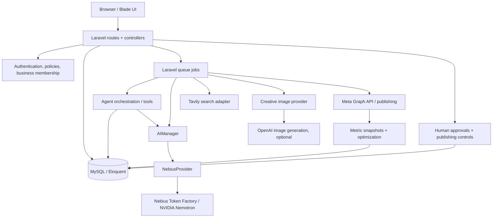
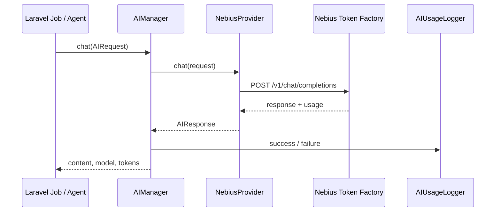

# PostGenius Agent — System Architecture

**Version:** Final-source documentation, 30 October 2026  
**Codebase reviewed:** `postgenious-agent-code.zip` (684 ZIP entries)  
**Application:** Laravel 13 / PHP 8.3+ multi-business marketing workspace

## 1. Executive summary

PostGenius Agent links marketing research, evidence-backed strategy, agent-run planning, content generation, creative design, approvals, scheduling, and reporting. Laravel controllers and policies govern user access; Eloquent models persist each stage; queued jobs execute long-running AI and integration work. NVIDIA Nemotron is reached through Nebius Token Factory using a shared AI provider layer.

This document describes the code in the submitted archive. It does not certify successful live API calls or production security testing.

## 2. Logical architecture



## 3. Core application layers

| Layer | Relevant code | Responsibility |
|---|---|---|
| HTTP interface | `routes/web.php`, `routes/auth.php`, `routes/admin.php`, `routes/phase*.routes.php` | Routes, auth boundaries, throttling |
| User interface | `resources/views/`, `app/Http/Controllers/` | Blade workspaces, forms, dashboards |
| Domain persistence | `app/Models/`, `database/migrations/` | Businesses, campaigns, research, strategies, runs, content, creatives, publications |
| AI integration | `app/AI/DTOs/`, `app/AI/Services/AIManager.php`, `app/AI/Providers/NebiusProvider.php` | Provider-neutral requests, inference, usage logging |
| Agent execution | `app/AI/Agents/`, `app/AI/Content/`, `app/AI/Creative/`, `app/AI/Orchestration/` | Research, strategy, content, creative direction, run coordination |
| Tool calling | `app/AI/Tools/` | Registered read tools for business, campaign, research, strategy, actions |
| Asynchronous jobs | `app/Jobs/` | Background research, strategy, run execution, generation, publishing, analytics |
| Integrations | `app/Research/`, `app/Social/`, `app/Analytics/` | Tavily, Meta, metrics normalization |
| Governance | `app/AgentGovernance/`, `app/Production/` | Action limits, publishing kill switch, readiness checks |
| Optimization | `app/Optimization/`, `app/AgentLoop/` | Recommendations, evidence, cycles and actions |

## 4. Main data relationships

The application defines models including `Business`, `MarketingGoal`, `Campaign`, `ResearchRun`, `CampaignStrategy`, `AgentRun`, `AgentTask`, `ContentAsset`, `CreativeAsset`, `CreativeApproval`, `SocialAccount`, `SocialPublication`, `SocialPublicationEvent`, `PublicationMetricSnapshot`, `AIRequestLog`, `AgentActivity`, `AgentGovernanceLimit`, and `SystemSetting`.

Typical relationship chain:

```text
User -- business membership --> Business
Business --> MarketingGoal --> Campaign
Campaign --> ResearchRun --> CampaignStrategy
Campaign --> AgentRun --> AgentTask
AgentTask --> ContentAsset --> CreativeAsset
ContentAsset / CreativeAsset --> Review / Approval
Approved content --> SocialPublication --> PublicationMetricSnapshot
```

This is a conceptual map, not a generated database ERD. Consult migrations and model relationships for exact foreign keys, cardinality, and deletion behavior.

## 5. Request and execution lifecycle

1. An authenticated user selects a business and campaign.
2. A controller verifies business membership and/or Laravel policy authorization.
3. A research or strategy controller creates a persistent run record and dispatches a job.
4. A worker executes the corresponding agent, which calls `AIManager` and any research tools.
5. The AI response is parsed, validated, logged, and persisted, or the run is marked failed.
6. Once research and strategy prerequisites are satisfied, the user can create an `AgentRun`.
7. The orchestrator gathers business/campaign/research/strategy context using registered tools and creates execution tasks.
8. The Content Agent produces a `ContentAsset`; the Creative Agent prepares a visual specification and can use a separate image provider to create a `CreativeAsset`.
9. Humans review generated materials. Publishing requires configured social accounts, safety checks, and a scheduler/worker.
10. Analytics jobs collect available metrics and optimization modules use the recorded evidence.

## 6. NVIDIA Nemotron request path



`AIRequest` carries prompt messages, generation parameters, optional tools, `jsonMode`, and feature/business metadata. `NebiusProvider` selects the model from request override or `config('ai.providers.nebius.model')`; JSON mode requests `response_format: {"type":"json_object"}`. The adapter returns an `AIResponse` with content, model, token counts, latency, and optional tool calls.

The configured model in `.env.example` is `nvidia/NVIDIA-Nemotron-3-Nano-30B-A3B`. Availability depends on the actual Nebius account and deployed configuration.

## 7. Research and strategy pipeline

`ResearchAgent` uses `WebSearchManager` and `ResearchEvidenceBuilder`; `TavilySearchProvider` performs HTTP search requests. The agent first plans research, then collects evidence, and then requests an analysis. A run without usable sources fails rather than silently producing evidence-free research.

`StrategyAgent` consumes campaign and research records, requests structured output, validates the result, and saves strategy records/actions/evidence. Its JSON retry and validation logic should be tested against real provider responses.

## 8. Content and creative pipeline

`ContentAgent` generates structured copy, then persists a `ContentAsset` linked to the campaign, business, agent run, and task. A queued `AgentTask` is not yet a completed Content Asset.

`CreativeAgent` receives a Content Asset and uses the language model to produce a visual brief containing fields such as `headline`, `visual_direction`, `composition`, `color_palette`, `typography`, `image_prompt`, and `accessibility_alt`. `OpenAIImageProvider` separately renders image bytes; `ImageProviderFactory` can disable image generation when not configured. `BrandGuardian` and creative approvals provide additional review steps.

**Nemotron reasons about creative direction; OpenAI renders images.**

## 9. Publishing and analytics

`SocialConnectionController` implements Meta OAuth flows. `MetaPublisher` supports Facebook and Instagram publishing using Meta Graph API. Publication jobs and the scheduler dispatch due records. `PublishingSafety` checks a production readiness flag, `PUBLISH_KILL_SWITCH`, governance enablement, and business action limits before publishing.

`AnalyticsSyncService`, `MetaInsightsClient`, `MetricNormalizer`, and `PublicationMetricSnapshot` support recorded metrics. `OptimizationAgent` and related services consume evidence to produce recommendations.

**Release observation:** The supplied `routes/console.php` schedules `DispatchDueSocialPublications`, while `DispatchDuePublicationsSafely` also exists. Before production use, verify that the active scheduler calls the intended safety-checked dispatcher and that no duplicate dispatcher runs. Do not assume the presence of the safer job means it is scheduled.

## 10. Route composition and access

The application loads `routes/public_site.php`, `routes/auth.php`, and `routes/admin.php` from `routes/web.php`. Additional feature route files, including Phase 18–20, are required inside `routes/auth.php`. The `admin` middleware alias is registered in `bootstrap/app.php`.

For an authoritative inventory of routes in the installed application, run:

```bash
php artisan route:list
php artisan route:list --path=content-agent
php artisan route:list --path=creative-agent
php artisan route:list --path=approvals
php artisan route:list --path=performance
```

## 11. Operations and observability

- `AIUsageLogger` stores request status, provider/model, token counts, latency, feature, and metadata in `AIRequestLog`.
- `AgentActivityLogger` and `AgentActivity` record run activity.
- Laravel queue workers process jobs; configure a supervisor and monitor failed jobs.
- `Phase21Readiness` provides a read-only `php artisan phase21:check` command.
- `/up` is registered through Laravel's health routing; `InternalHealthController` is present for additional checks.

Suggested diagnostics:

```bash
php artisan phase21:check
php artisan schedule:list
php artisan queue:failed
php artisan test
```

## 12. Security and deployment boundaries

- Keep `.env`, production credentials, access tokens, private storage, and application logs out of Git.
- Use `APP_ENV=production`, `APP_DEBUG=false`, HTTPS, secure cookies, and a unique application key.
- Verify policies and business membership on **every** read/write path, including admin and exports.
- Use a dedicated staging database for migrations and tests.
- Review queue idempotency, publication retries, OAuth state validation, and secret storage.
- Keep publishing disabled until a supervised staging run has passed.

**Important source issue:** The uploaded `.env.example` contains a nonempty `APP_KEY` and an example `ADMIN_PASSWORD=12345678`. Clear the key and remove or replace the default password before making the repository public. If that application key is used by any deployment, do not rotate it blindly; plan a controlled rotation.

## 13. Current verification boundary

The code archive contains the listed classes, routes, and configurations. This documentation was prepared by inspecting those files; it is not a live integration test or a guarantee that all modules, routes, workers, or publishing integrations pass acceptance testing.
