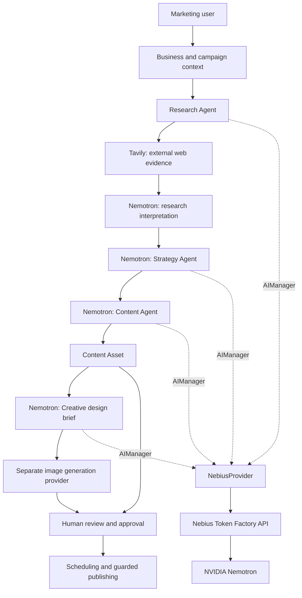

# How PostGenius Agent Uses NVIDIA Nemotron

**Technical integration note for the PostGenius Agent public repository**

**Project:** PostGenius Agent  
**Core model configuration:** `nvidia/NVIDIA-Nemotron-3-Nano-30B-A3B`  
**Inference platform:** Nebius Token Factory  
**Application:** Laravel / PHP  
**Reviewed source:** `postgenious-agent-latest.zip` (the last complete source archive supplied). Later Phase 16–21 changes were delivered separately and must be verified in the final merged repository.

> This document explains the integration demonstrated by the application's source code. It does not claim independent verification of live inference, throughput, accuracy, or competition eligibility.

## 1. Why NVIDIA Nemotron

PostGenius Agent is designed to transform a marketing objective into connected outputs: research, strategy, written content, and creative direction. These stages require language understanding and structured reasoning, not just isolated text generation.

The application uses **NVIDIA Nemotron through Nebius Token Factory** as its configured default language model. Nemotron interprets supplied business context and research material, develops campaign recommendations, writes structured content, and prepares specifications for visual creatives.

Nemotron is **not** the image-rendering engine and **not** the external web search engine. Those responsibilities are handled by separate services.

## 2. Where the integration lives in the code

| Source file | Responsibility |
|---|---|
| `config/ai.php` | Reads the default AI provider, Nebius endpoint, API key, model name, timeout, and generation defaults from environment variables. |
| `app/AI/Providers/NebiusProvider.php` | Converts an internal `AIRequest` into a Nebius-compatible chat-completion request and parses the provider response. |
| `app/AI/Services/AIManager.php` | Selects the provider, delegates inference, and records success/failure through `AIUsageLogger`. |
| `app/AI/DTOs/AIRequest.php` | Carries messages, model overrides, temperature, token limits, JSON-mode selection, and request metadata. |
| `app/AI/Agents/ResearchAgent.php` | Uses AI to plan and analyze research alongside external search results. |
| `app/AI/Agents/StrategyAgent.php` | Requests structured campaign strategies, validates output, and handles invalid responses. |
| `app/AI/Content/ContentAgent.php` | Uses AI to generate structured marketing content from campaign/run context. |
| `app/AI/Creative/CreativeAgent.php` | Uses AI to produce a structured visual brief and image prompt based on a Content Asset. |

The source shows that these agent classes call `AIManager::chat()` rather than sending requests directly to Nebius. That keeps authentication, model selection, response handling, and usage logging in one shared layer.

## 3. End-to-end architecture



The diagram represents the intended application flow. A stage can fail, wait in a queue, or require user action; it is not a claim that every stage always runs autonomously.

## 4. Request lifecycle

1. **A user starts an operation.** The Laravel application identifies the business, campaign, task, or content asset.
2. **An agent constructs a prompt.** The prompt includes role instructions and relevant business or campaign context.
3. **The agent creates an `AIRequest`.** The request can specify `messages`, `temperature`, `maxTokens`, `feature`, `userId`, `businessId`, metadata, and `jsonMode`.
4. **`AIManager` selects Nebius.** The default provider comes from `config('ai.default')`, which is driven by `AI_DEFAULT_PROVIDER`.
5. **`NebiusProvider` calls the inference API.** The reviewed code sends an authenticated JSON request to `chat/completions` relative to `NEBIUS_BASE_URL`.
6. **The provider parses the response.** The returned model, content, and available usage information are wrapped in the application's response object.
7. **Usage is logged.** `AIManager` calls `AIUsageLogger::success()` or `failure()`.
8. **The agent validates and saves its result.** Structured responses are parsed and validated before the associated application record is considered complete.

### API request shape

The following is a **simplified illustration** of the payload assembled in `NebiusProvider.php`; it is not a copy of any secret-bearing request:

```json
{
  "model": "nvidia/NVIDIA-Nemotron-3-Nano-30B-A3B",
  "messages": [
    {
      "role": "system",
      "content": "You are a marketing strategy assistant. Return valid JSON."
    },
    {
      "role": "user",
      "content": "Create a campaign strategy from the supplied business and research context."
    }
  ],
  "temperature": 0.3,
  "max_tokens": 1600,
  "response_format": {
    "type": "json_object"
  }
}
```

The reviewed adapter sends this type of request to:

```text
POST https://api.tokenfactory.nebius.com/v1/chat/completions
Authorization: Bearer <NEBIUS_API_KEY>
Content-Type: application/json
```

The precise request content, generation settings, and response-format options vary by agent. JSON mode is added only when the `AIRequest` requests it. Model and endpoint support should be verified with the active Nebius deployment.

## 5. Nemotron's role in each agent

### A. Research Agent — organizing and interpreting evidence

**Input:** Business context, campaign objective, research instructions, and results from the configured external search provider.

**Nemotron's role:** Assist with research planning and interpret collected evidence into a structured analysis useful for downstream strategy.

**Other system's role:** Tavily retrieves external search results. Nemotron does not itself prove a claim or fetch web pages merely by generating text.

**Output:** Research records and analysis associated with the campaign. The workflow can fail if evidence is insufficient or the model returns unusable structured output.

**Source:** `app/AI/Agents/ResearchAgent.php`

### B. Strategy Agent — structured campaign planning

**Input:** Campaign details and completed research context.

**Nemotron's role:** Produce a structured strategy rather than a free-form chat reply. The code requests JSON mode, validates the result, and makes a further attempt when the response is invalid or incomplete.

**Output:** A campaign strategy saved only after the required validation succeeds.

**Source:** `app/AI/Agents/StrategyAgent.php`

**Reliability consideration:** Valid JSON is necessary but not sufficient for a good strategy. Claims and recommendations still need human review.

### C. Content Agent — campaign-aware marketing copy

**Input:** An eligible agent task and related campaign/run/business information.

**Nemotron's role:** Generate structured copy for a marketing asset, based on the supplied instructions and context. The reviewed implementation calls `AIManager::chat()` with `jsonMode: true`, parses the response, and creates a `ContentAsset` record.

**Output:** Draft content for the Content Library and subsequent human review.

**Source:** `app/AI/Content/ContentAgent.php`

**Operational distinction:** A content task queued for generation is not yet a Content Asset. The generation job must finish and persist a valid result.

### D. Creative Agent — design reasoning, not image rendering

**Input:** An existing `ContentAsset`, including business identity, brand voice, platform, title, hook, caption, call to action, and creative brief.

**Nemotron's role:** Act as a design-director reasoning layer. In the reviewed source, the prompt asks for JSON fields including:

- `headline`
- `visual_direction`
- `composition`
- `color_palette`
- `typography`
- `image_prompt`
- `accessibility_alt`

The implementation validates that `image_prompt` is present and nonempty.

**Output:** A structured creative specification that can be passed to a **separate image-generation provider**.

**Source:** `app/AI/Creative/CreativeAgent.php`

**Important:** Do not describe images produced by OpenAI or another image provider as “generated by Nemotron.” Nemotron prepares the visual direction and prompt in this architecture.

## 6. Why this is more than a chatbot

The distinction is in the **application orchestration**:

- Agent outputs are associated with persistent businesses, campaigns, runs, and content assets.
- Research informs strategy rather than being an unrelated conversation.
- Strategy informs content creation.
- Content becomes input to creative direction.
- Jobs can execute asynchronously and expose progress or failure states.
- Provider usage and errors are recorded centrally.
- Generated materials pass through human review before publication.

These are design and implementation characteristics observed in the source. They should be demonstrated with actual successful runs during judging.

## 7. Structured output and failure handling

The reviewed code uses several mechanisms to make model output operationally usable:

**JSON mode:** `NebiusProvider.php` adds `response_format: {"type":"json_object"}` for requests marked `jsonMode: true`.

**Parsing and validation:** Agents use the application's JSON extraction and validation logic to determine whether the returned content is usable.

**Strategy retry:** `StrategyAgent.php` contains a retry attempt for invalid or incomplete responses and records diagnostic metadata such as response length and hash.

**Usage logging:** `AIManager.php` records provider success and failure through `AIUsageLogger`.

**Background execution:** Laravel jobs allow long-running agent work to execute outside the initial browser request.

**Limitations:** The existence of these mechanisms does not guarantee that every malformed response, provider outage, timeout, duplicate job, or schema mismatch is handled correctly. Those cases must be tested.

## 8. Environment configuration

Use a private `.env` file or deployment secret manager:

```dotenv
AI_DEFAULT_PROVIDER=nebius
AI_REQUEST_TIMEOUT=120

NEBIUS_BASE_URL=https://api.tokenfactory.nebius.com/v1/
NEBIUS_DEFAULT_MODEL=nvidia/NVIDIA-Nemotron-3-Nano-30B-A3B
NEBIUS_API_KEY=REPLACE_WITH_YOUR_PRIVATE_KEY
NEBIUS_TEMPERATURE=0.6
NEBIUS_MAX_TOKENS=4096

RESEARCH_SEARCH_PROVIDER=tavily
TAVILY_API_KEY=REPLACE_WITH_YOUR_PRIVATE_KEY
```

The exact model string must match the model identifier available to your Nebius account. Keep keys out of the public repository, logs, screenshots, and demo recordings.

### Quick configuration check

```bash
php artisan optimize:clear
php artisan tinker --execute="dump(config('ai.default'), config('ai.providers.nebius.model'));"
```

This verifies Laravel's loaded configuration, **not** a successful inference call. Use the project's working AI test command or playground for a real request, and check the provider response without exposing credentials.

## 9. What to show judges

A convincing short demonstration should show **evidence of real inference**, not just static dashboard pages.

| Demo moment | Evidence to show |
|---|---|
| AI configuration | Nemotron model selected in the application |
| Research | A completed research record, including external evidence |
| Strategy | Structured campaign strategy based on that research |
| Content | Completed generation task and saved Content Asset |
| Creative | Nemotron-produced visual brief and separately rendered image |
| Monitoring | Agent status and AI usage record |
| Safety | Human approval requirement before publication |

When possible, show a live Nemotron-backed operation alongside a previously completed campaign, so the demo remains understandable even if a background job takes time.

## 10. Responsible AI and transparency

- Treat generated recommendations as drafts until reviewed.
- Preserve the distinction between retrieved evidence and model interpretation.
- Avoid fabricated sources, metrics, testimonials, and performance claims.
- Review images for rights, accuracy, trademarks, and brand fidelity.
- Apply business-level authorization to prompts, records, and outputs.
- Keep API credentials and private customer information out of public artifacts.
- Do not claim that the system has executed a publication unless the relevant integration confirms it.

## 11. Technical summary for reviewers

> **PostGenius Agent uses NVIDIA Nemotron, served through Nebius Token Factory, as its language reasoning layer.** Laravel agents assemble context-specific requests and route them through a shared `AIManager` and `NebiusProvider`. Nemotron helps interpret research, develop structured campaign strategies, generate marketing copy, and produce creative design specifications. Tavily supplies external research, while a separate image-generation service renders visuals. Persistent campaign records, queue-backed execution, usage logging, and human approvals connect these capabilities into a coordinated marketing workflow.

## 12. Source references

The descriptions above were checked against these files in the supplied `postgenious-agent-latest.zip` archive:

```text
config/ai.php
app/AI/Providers/NebiusProvider.php
app/AI/Services/AIManager.php
app/AI/DTOs/AIRequest.php
app/AI/Agents/ResearchAgent.php
app/AI/Agents/StrategyAgent.php
app/AI/Content/ContentAgent.php
app/AI/Creative/CreativeAgent.php
```

**Repository placement:** Save this document as `docs/NVIDIA_NEMOTRON_INTEGRATION.md` and link to it from the main `README.md`.

**Verification note:** This is a source-grounded technical explanation, not a live production audit. Verify the final merged Phase 1–21 deployment and current provider configuration before submission.
